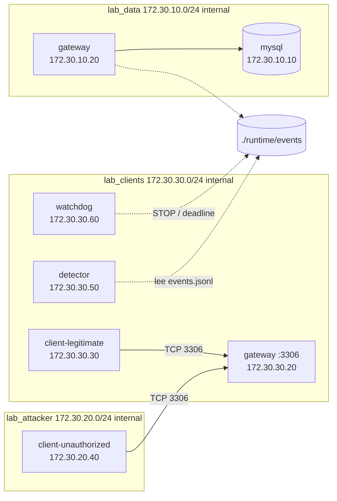
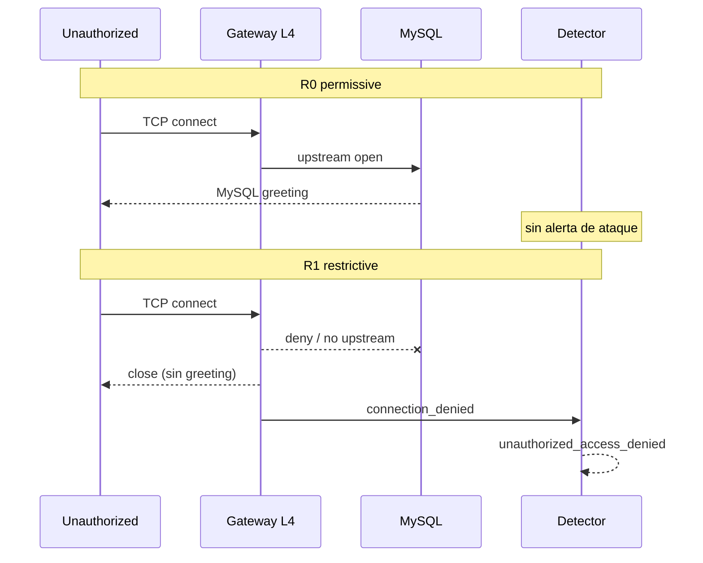

# Defensa en profundidad — Experimento 2: exposición y control de acceso L4

Laboratorio aislado de **Ingeniería del Caos de Seguridad** para demostrar, de forma reproducible, la diferencia entre un baseline permisivo (**R0**) y un estado con segmentación/control de acceso por proxy TCP L4 más detección como código (**R1**).

| Campo | Valor |
|---|---|
| Repositorio | `hotel-fastify` |
| Rama de trabajo | `feat/defensa-profundidad-oci` |
| Release protegida (no modificada) | `v1.2.0` (`0ce0e41`) |
| Ámbito | Solo `seguridad-caos-exp2/` (Docker local) |
| R0 oficial | [`r0-20261118T051339Z`](evidencias-publicas/r0/r0-20261118T051339Z/) |
| R1 oficial | [`r1-20261118T051805Z`](evidencias-publicas/r1/r1-20261118T051805Z/) |
| Auditoría final | [`docs/15-auditoria-final-r0-r1.md`](docs/15-auditoria-final-r0-r1.md) |
| Veredicto auditado | **VÁLIDO CON LIMITACIONES** |

> **Precisión crítica:** este laboratorio **no** aplica NetworkPolicy en OKE, **no** segmenta el clúster OCI de producción y **no** sustituye los controles reales de Sports AWS, Hotel OCI ni Cine GCP.

---

## Índice

1. [Título, contexto y objetivo](#1-título-contexto-y-objetivo)
2. [Arquitectura multinube original](#2-arquitectura-multinube-original)
3. [Alcance y justificación del laboratorio aislado](#3-alcance-y-justificación-del-laboratorio-aislado)
4. [Arquitectura técnica del laboratorio](#4-arquitectura-técnica-del-laboratorio)
5. [Inventario de controles por capa](#5-inventario-de-controles-por-capa)
6. [Reglas de compromiso](#6-reglas-de-compromiso)
7. [Estado estable de seguridad](#7-estado-estable-de-seguridad)
8. [Hipótesis falsable](#8-hipótesis-falsable)
9. [Diseño experimental y variables controladas](#9-diseño-experimental-y-variables-controladas)
10. [Ejecución R0](#10-ejecución-r0)
11. [Implementación de G1 y G2](#11-implementación-de-g1-y-g2)
12. [Ejecución R1](#12-ejecución-r1)
13. [Comparación R0/R1](#13-comparación-r0r1)
14. [Métricas MTTD, MTTC, cobertura y FP](#14-métricas-mttd-mttc-cobertura-y-fp)
15. [Detección como código](#15-detección-como-código)
16. [Parada, TTL y rollback](#16-parada-ttl-y-rollback)
17. [Evidencias y trazabilidad](#17-evidencias-y-trazabilidad)
18. [Mapeo MITRE ATT&CK y D3FEND](#18-mapeo-mitre-attck-y-d3fend)
19. [Trazabilidad ISO/IEC 27001 y NIST](#19-trazabilidad-isoiec-27001-y-nist)
20. [Uso de IA y validación humana](#20-uso-de-ia-y-validación-humana)
21. [Limitaciones y riesgos residuales](#21-limitaciones-y-riesgos-residuales)
22. [Lecciones aprendidas](#22-lecciones-aprendidas)
23. [Reproducción controlada](#23-reproducción-controlada)
24. [Conclusiones](#24-conclusiones)

---

## 1. Título, contexto y objetivo

### Objetivo

Medir, con evidencias UTC correlacionables, si un **punto de control de red L4 (proxy)** con política versionada y una **regla de detección basada en eventos del gateway**:

1. reduce la exposición del path MySQL frente a un origen no autorizado, y  
2. genera alerta independiente de la sonda,  
sin degradar al cliente legítimo.

### Contexto académico / game day

El experimento forma parte de la línea de **Defensa en profundidad** del proyecto multinube Hotel–Sports–Cine. Se ejecuta **después** de la release de Ingeniería del Caos `v1.2.0`, sin alterarla.

---

## 2. Arquitectura multinube original

El proyecto `hotel-fastify` integra (fuera del alcance de este laboratorio):

| Dominio | Responsable | Notas |
|---|---|---|
| Hotel (OCI / OKE) | Samuel | API Fastify, MySQL de entorno, NLB |
| Sports (AWS) | Jarrison | Integración AWS |
| Cine (GCP) | Daniel | Integración GCP |
| Observabilidad compartida (OCI) | Equipo | OTel / Prometheus / Grafana / Tempo |

Hallazgo de arquitectura real documentado previamente: **Flannel Overlay en OKE sin evidencia de enforcement efectivo de NetworkPolicy**. Ese hallazgo **motiva** el laboratorio; **no** se “corrige” aquí el clúster.

Documentación de limitaciones OKE: [`docs/10-limitaciones-oke.md`](docs/10-limitaciones-oke.md).

---

## 3. Alcance y justificación del laboratorio aislado

| Incluye | Excluye |
|---|---|
| Docker Compose local `seguridad-caos-exp2` | Terraform, kubectl, OCI/AWS/GCP CLI |
| Proxy L4 + políticas R0/R1 | NetworkPolicy en OKE |
| Detector JSONL + regla YAML | Cambios a observabilidad compartida |
| Watchdog, STOP, rollback del lab | Modificar Sports/Cine/Hotel prod |
| Evidencias bajo `evidencias/` | Reescritura de `v1.2.0` |

**Por qué laboratorio:** sin CNI con enforcement confiable, un experimento de segmentación en OKE no sería reproducible ni seguro para el game day multinube. El lab permite **falsar hipótesis** con IPs fijas, políticas versionadas y métricas honestas (`null` cuando no hay detección/contención).

---

## 4. Arquitectura técnica del laboratorio

### Diagrama de redes



El gateway participa en las tres redes. **MySQL solo está en `lab_data`** con el gateway: los clientes de prueba no tienen ruta L3 directa al motor.

Detalle: [`docs/01-arquitectura.md`](docs/01-arquitectura.md), Compose: [`docker-compose.yml`](docker-compose.yml).

### Capas distinguibles

| Capa | Qué se mide |
|---|---|
| TCP al gateway | Handshake con el proxy (`tcp_connected`) |
| Reenvío / path MySQL | Greeting MySQL (`mysql_greeting_received`) |
| Auth MySQL | **No** ejercitada en R0/R1 (sonda no autentica) |
| Acceso a datos | **No** ejercitado (sin SELECT de ataque) |

---

## 5. Inventario de controles por capa

| Capa | Control | Artefacto |
|---|---|---|
| Red Docker | Bridges `internal:true`, anti-bypass MySQL | [`docker-compose.yml`](docker-compose.yml) |
| Acceso L4 | Proxy + políticas versionadas | [`gateway/`](gateway/), [`policy/`](policy/) |
| Detección | Regla YAML + detector de eventos | [`detector/rules/unauthorized_deny.yaml`](detector/rules/unauthorized_deny.yaml) |
| Operación | Watchdog autónomo, STOP/ABORT | [`docs/14-watchdog.md`](docs/14-watchdog.md) |
| Datos (prep.) | Usuarios mínimo privilegio sintéticos | [`mysql/init.sql`](mysql/init.sql) (no eje R0/R1) |

Inventario ampliado: [`docs/02-inventario-controles.md`](docs/02-inventario-controles.md).

---

## 6. Reglas de compromiso

Resumen operativo (detalle: [`docs/03-reglas-compromiso.md`](docs/03-reglas-compromiso.md)):

- Solo recursos del proyecto Docker `seguridad-caos-exp2`.
- Prohibido tocar OCI/AWS/GCP/OKE/Terraform/Actions.
- Condición adversa: sonda TCP controlada vía gateway (sin explotación MySQL).
- TTL/watchdog + STOP; limpieza acotada; sin `docker system prune`.
- Resultados del lab **no** se reportan como endurecimiento de OKE.

---

## 7. Estado estable de seguridad

Antes de cada inyección se exige (documentado en [`docs/05-estado-estable.md`](docs/05-estado-estable.md)):

- MySQL healthy, gateway/detector/watchdog operativos.
- Política activa correcta (R0 o R1 según ronda).
- `run_context.json` con `run_id` / `scenario` / `policy_id` **antes** del boot del gateway.
- Cliente legítimo con greeting MySQL vía gateway.
- Sin alertas de ataque previas del mismo `run_id`.

---

## 8. Hipótesis falsable

**H1 (R1):** con política restrictiva, el origen `172.30.20.40` **no** obtiene path MySQL (`mysql_greeting_received=false` / `connection_denied`), se genera alerta correlacionada, y el legítimo `172.30.30.30` conserva greeting.

**H0 (R0):** con política permisiva, el mismo intento **sí** obtiene path MySQL; detección/contención de amenaza pueden ser no observadas.

Hipótesis detallada: [`docs/04-hipotesis.md`](docs/04-hipotesis.md).

---

## 9. Diseño experimental y variables controladas

| Variable | Valor fijo R0 y R1 |
|---|---|
| Origen no autorizado | `172.30.20.40` |
| Gateway (attacker view) | `172.30.20.20:3306` |
| MySQL | `172.30.10.10:3306` |
| Sonda | `clients/probe.py` (TCP + greeting) |
| Intentos | 1 unauthorized + 1 legitimate |
| MaxMinutes | 30 |

**Única diferencia de seguridad entre rondas:** política activa (`r0-permissive` vs `r1-restrictive`) y, en R1, la regla de detección sobre `connection_denied`.

Procedimientos: [`docs/06-procedimientos-r0-r1.md`](docs/06-procedimientos-r0-r1.md).

---

## 10. Ejecución R0

| Campo | Valor verificado |
|---|---|
| `run_id` | `r0-20261118T051339Z` |
| Política | `seguridad-caos-exp2-r0-permissive` |
| Unauthorized | `tcp_connected=true`, **`mysql_greeting_received=true`**, `access_blocked=false` |
| Gateway | `connection_attempt` + **`connection_allowed`** (`default_allow`, `upstream_opened=true`) |
| Detección de ataque | **No** (solo `detector_started`) |
| Contención | **No observada** |
| Legítimo | greeting OK |

Evidencias: [`evidencias-publicas/r0/r0-20261118T051339Z/`](evidencias-publicas/r0/r0-20261118T051339Z/) · [`events.jsonl`](evidencias-publicas/r0/r0-20261118T051339Z/events.jsonl) · [`metrics.json`](evidencias-publicas/r0/r0-20261118T051339Z/metrics.json) · [`R0-SUMMARY.json`](evidencias-publicas/r0/r0-20261118T051339Z/R0-SUMMARY.json).

> R0 demuestra **exposición del path MySQL vía proxy**, no autenticación MySQL ni acceso a filas de datos.

---

## 11. Implementación de G1 y G2

### G1 — Segmentación / control de reenvío verificable

- Política [`policy/r1-restrictive.yaml`](policy/r1-restrictive.yaml): `denied_sources: [172.30.20.40]`, allow del legítimo.
- Enforcement en [`gateway/gateway.py`](gateway/gateway.py) (deny → no `create_connection` upstream).

### G2 — Detección automatizada independiente de la sonda

- Regla [`detector/rules/unauthorized_deny.yaml`](detector/rules/unauthorized_deny.yaml).
- Detector [`detector/detector.py`](detector/detector.py) consume `events.jsonl` del gateway.

---

## 12. Ejecución R1

| Campo | Valor verificado |
|---|---|
| `run_id` | `r1-20261118T051805Z` |
| Política | `seguridad-caos-exp2-r1-restrictive` |
| Unauthorized | TCP al gateway **sí**; **greeting MySQL no**; `access_blocked=true` |
| Gateway | **`connection_denied`**, `upstream_opened=false`, `mysql_forwarding=false` |
| Alerta | **`unauthorized_access_denied`** correlacionada al deny |
| Legítimo | greeting OK |

Evidencias: [`evidencias-publicas/r1/r1-20261118T051805Z/`](evidencias-publicas/r1/r1-20261118T051805Z/) · [`events.jsonl`](evidencias-publicas/r1/r1-20261118T051805Z/events.jsonl) · [`alerts.jsonl`](evidencias-publicas/r1/r1-20261118T051805Z/alerts.jsonl) · [`metrics.json`](evidencias-publicas/r1/r1-20261118T051805Z/metrics.json) · [`R1-SUMMARY.json`](evidencias-publicas/r1/r1-20261118T051805Z/R1-SUMMARY.json).

### Incidente operativo (R1 parcial)

Primer intento `r1-20261118T051705Z` abortó el runner al interpretar exit code `1` de la sonda bloqueada como fallo de Compose. El deny ya había ocurrido. Quedó archivado en [`evidencias-publicas/r1/r1-20261118T051705Z-PARTIAL-ABORT/`](evidencias-publicas/r1/r1-20261118T051705Z-PARTIAL-ABORT/). La ejecución **oficial** es `r1-20261118T051805Z` (mismo método experimental, runner corregido). Detalle en la [auditoría final](docs/15-auditoria-final-r0-r1.md).

---

## 13. Comparación R0/R1

| Métrica | R0 | R1 |
|---|---|---|
| TCP no autorizado al gateway | true | true |
| Greeting MySQL no autorizado | **true** | **false** |
| `connection_denied` | false | **true** |
| Detección de ataque | false | **true** |
| Contención | not_observed | **preventive** |
| Contención reactiva | false | false |
| FP sobre legítimo | false | false |
| Continuidad legítima (greeting) | true | true |

Tabla generada también en [`evidencias-publicas/r1/r1-20261118T051805Z/comparison-r0-r1.md`](evidencias-publicas/r1/r1-20261118T051805Z/comparison-r0-r1.md).



---

## 14. Métricas MTTD, MTTC, cobertura y FP

### R1 (n=1 — no son promedios)

| Campo | Timestamp / valor | Interpretación |
|---|---|---|
| t0 | `2026-11-18T05:18:21.270Z` | `connection_attempt` unauthorized |
| t2 | `2026-11-18T05:18:21.275Z` | `connection_denied` (**bloqueo preventivo = 5 ms**) |
| t1 | `2026-11-18T05:18:21.290Z` | alerta ataque (**MTTD = 20 ms**) |
| MTTC reactivo | **no aplica / no observado** | no hay remediación post-detección |
| Cobertura | **1/1** en esta ejecución | deny ∧ alerta correlacionada |
| FP observados | **0** | sin alerta de ataque al legítimo |

**t2 ocurre antes de t1:** la contención es **preventiva** en el proxy; no debe presentarse como MTTC reactivo.

> **Nota sobre el campo JSON `mttc_ms`:** en `metrics.json` de R1 aparece `mttc_ms: 5.0`. Ese valor es el **bloqueo preventivo** (t2 − t0), no una contención reactiva posterior a la alerta. MTTC reactivo = **no aplica**. Cobertura: R0 **0/1**, R1 **1/1** (n=1). Originales locales no versionados; paquete público en [`evidencias-publicas/`](evidencias-publicas/) ([manifiesto SHA256](evidencias-publicas/SANITIZATION-MANIFEST.json)).

### R0

| Campo | Valor |
|---|---|
| t0 | `2026-11-18T05:13:54.802Z` |
| t1 / t2 / MTTD / MTTC | **`null` / no_observed** (sin inventar ceros) |

Criterios: [`docs/08-metricas-exito.md`](docs/08-metricas-exito.md).

---

## 15. Detección como código

| Elemento | Ubicación |
|---|---|
| Regla versionada | [`detector/rules/unauthorized_deny.yaml`](detector/rules/unauthorized_deny.yaml) |
| Casos +/− en R1 | [`evidencias/r1/.../rule-positive-negative.json`](evidencias-publicas/r1/r1-20261118T051805Z/rule-positive-negative.json) |
| Fixtures unitarios | [`tests/fixtures/`](tests/fixtures/) |
| Tests | [`tests/test_policy_and_detection.py`](tests/test_policy_and_detection.py), [`tests/test_watchdog.py`](tests/test_watchdog.py) |

- **Positivo (R1 runtime):** `connection_denied` de `172.30.20.40` → alerta.
- **Negativo (R1 runtime):** `connection_allowed` de `172.30.30.30` → sin alerta de ataque.
- `detector_started` **no** cuenta como detección del ataque.
- El detector **no** usa el exit code de la sonda como fuente de verdad.

---

## 16. Parada, TTL y rollback

| Mecanismo | Descripción | Docs / scripts |
|---|---|---|
| STOP / ABORT | Flag en `./runtime/events` montado en contenedores | [`docs/07-parada-rollback.md`](docs/07-parada-rollback.md) |
| Watchdog | Contenedor autónomo; lee `experiment_deadline.json`; escribe STOP al vencer | [`docs/14-watchdog.md`](docs/14-watchdog.md), [`docs/13-ttl-y-limitaciones.md`](docs/13-ttl-y-limitaciones.md) |
| Rollback | `scripts/stop-experiment.ps1`: STOP, preservar evidencias, política R0, `compose stop`, verificación de estado | [`scripts/stop-experiment.ps1`](scripts/stop-experiment.ps1) |

En R0/R1 oficiales **no** hay evidencia de vencimiento de TTL; el exit code 137 del watchdog se asocia a paradas Docker (`stop`), no a métricas inválidas (ver auditoría).

---

## 17. Evidencias y trazabilidad

| Artefacto | Enlace |
|---|---|
| Auditoría final | [docs/15-auditoria-final-r0-r1.md](docs/15-auditoria-final-r0-r1.md) |
| R0 pack | [evidencias-publicas/r0/r0-20261118T051339Z/](evidencias-publicas/r0/r0-20261118T051339Z/) |
| R0 journal | [evidencias/r0/.../journal.txt](evidencias-publicas/r0/r0-20261118T051339Z/journal.txt) |
| R0 events | [evidencias/r0/.../events.jsonl](evidencias-publicas/r0/r0-20261118T051339Z/events.jsonl) |
| R0 alerts | [evidencias/r0/.../alerts.jsonl](evidencias-publicas/r0/r0-20261118T051339Z/alerts.jsonl) |
| R0 metrics | [evidencias/r0/.../metrics.json](evidencias-publicas/r0/r0-20261118T051339Z/metrics.json) |
| R0 watchdog | [evidencias/r0/.../watchdog.jsonl](evidencias-publicas/r0/r0-20261118T051339Z/watchdog.jsonl) |
| R0 STOP | [evidencias/r0/.../STOP.txt](evidencias-publicas/r0/r0-20261118T051339Z/STOP.txt) |
| R1 pack | [evidencias-publicas/r1/r1-20261118T051805Z/](evidencias-publicas/r1/r1-20261118T051805Z/) |
| R1 journal | [evidencias/r1/.../journal.txt](evidencias-publicas/r1/r1-20261118T051805Z/journal.txt) |
| R1 events | [evidencias/r1/.../events.jsonl](evidencias-publicas/r1/r1-20261118T051805Z/events.jsonl) |
| R1 alerts | [evidencias/r1/.../alerts.jsonl](evidencias-publicas/r1/r1-20261118T051805Z/alerts.jsonl) |
| R1 metrics | [evidencias/r1/.../metrics.json](evidencias-publicas/r1/r1-20261118T051805Z/metrics.json) |
| R1 +/− regla | [evidencias/r1/.../rule-positive-negative.json](evidencias-publicas/r1/r1-20261118T051805Z/rule-positive-negative.json) |
| R1 watchdog | [evidencias/r1/.../watchdog.jsonl](evidencias-publicas/r1/r1-20261118T051805Z/watchdog.jsonl) |
| R1 STOP / rollback | [evidencias/r1/.../STOP.txt](evidencias-publicas/r1/r1-20261118T051805Z/STOP.txt), [final-state.txt](evidencias-publicas/r1/r1-20261118T051805Z/final-state.txt) |
| R1 parcial | [evidencias-publicas/r1/r1-20261118T051705Z-PARTIAL-ABORT/](evidencias-publicas/r1/r1-20261118T051705Z-PARTIAL-ABORT/) |
| Matriz trazabilidad | [docs/09-matriz-trazabilidad.md](docs/09-matriz-trazabilidad.md) |

Correlacionar siempre por `run_id` + `scenario` + `policy_id` (no mezclar rondas).

Los enlaces de esta sección apuntan al **paquete público sanitizado** (`evidencias-publicas/`). Los originales con rutas de host permanecen en `evidencias/` solo en el entorno local y están excluidos por `.gitignore`.

---

## 18. Mapeo MITRE ATT&CK y D3FEND

Mapeo **orientativo** del escenario de laboratorio (intento de alcanzar un servicio de datos vía red). No implica que todas las técnicas se hayan ejecutado íntegramente.

| Framework | ID | Relación con el lab | Estado |
|---|---|---|---|
| ATT&CK | [T1046](https://attack.mitre.org/techniques/T1046/) Network Service Discovery | Sonda TCP hacia servicio de datos expuesto vía path de red | Aplicable al intento |
| ATT&CK | [T1190](https://attack.mitre.org/techniques/T1190/) Exploit Public-Facing Application | **Pendiente de validación** como analogía (MySQL no es app pública; no hubo explotación) | No afirmar explotación |
| D3FEND | [D3-NI](https://d3fend.mitre.org/technique/d3f:NetworkIsolation/) Network Isolation | Redes Docker internal + separación `lab_data` | Aplicable al diseño |
| D3FEND | [D3-ITF](https://d3fend.mitre.org/technique/d3f:InboundTrafficFiltering/) Inbound Traffic Filtering | Deny de orígenes en proxy L4 (G1) | Aplicable con salvedad post-accept |
| D3FEND | [D3-NTA](https://d3fend.mitre.org/technique/d3f:NetworkTrafficAnalysis/) Network Traffic Analysis | Eventos/alertas del gateway/detector (G2) | Aplicable a telemetría del control point |

---

## 19. Trazabilidad ISO/IEC 27001 y NIST

Referencias de **alineación documental** (no certificación):

| Estándar | Control / concepto | Relación con el experimento | Estado |
|---|---|---|---|
| ISO/IEC 27001:2022 | A.8.20 Network security | Aislamiento de redes del lab + punto de control | Alineación de diseño |
| ISO/IEC 27001:2022 | A.8.16 Monitoring activities | Eventos UTC + detector | Alineación de diseño |
| ISO/IEC 27001:2022 | A.8.22 Segregation of networks | Separación attacker/clients/data | Alineación de lab |
| NIST SP 800-53 Rev. 5 | [SC-7](https://csrc.nist.gov/pubs/sp/800/53/r5/upd1/final) Boundary Protection | Gateway como frontera lógica hacia MySQL | Alineación de diseño |
| NIST SP 800-53 Rev. 5 | SI-4 System Monitoring | Alertas sobre denies | Alineación de diseño |
| NIST SP 800-53 Rev. 5 | AC-4 Information Flow Enforcement | Política allow/deny de reenvío | Alineación de diseño |
| NIST SP 800-207 | Zero Trust (never trust / verify / least privilege) | Política restrictiva + verificación continua vía eventos | **Pendiente** de evaluación formal ZT; solo analogía |

---

## 20. Uso de IA y validación humana

| Actividad | Rol de IA (Cursor/Composer) | Validación humana |
|---|---|---|
| Scaffold del laboratorio, scripts, docs | Asistencia de generación | Revisión DevSecOps / game day |
| Ejecución R0/R1 | Orquestación asistida vía runners | Comprobación de JSON originales |
| Auditoría final | Redacción asistida | Cruce con `events.jsonl` / `alerts.jsonl` / `metrics.json` |

No se afirma que un modelo haya “descubierto” métricas independientes de los archivos de evidencia. Las cifras citadas provienen de los JSON de `evidencias/`.

---

## 21. Limitaciones y riesgos residuales

1. Deny **post-accept**: el TCP al gateway puede completarse; se bloquea el **reenvío** a MySQL.
2. No es NetworkPolicy/CNI ni hardening OKE.
3. R0 no demuestra acceso autenticado a datos (solo greeting).
4. Métricas **n=1** (no SLA ni promedio).
5. Cobertura de G2 limitada a eventos emitidos por este gateway.
6. Representatividad parcial frente a Flannel Overlay real ([`docs/10-limitaciones-oke.md`](docs/10-limitaciones-oke.md)).

---

## 22. Lecciones aprendidas

- Separar **TCP al control point**, **path MySQL**, **auth** y **datos** evita sobreclaims.
- Los exit codes de sondas son **resultado experimental**, no fallo de infraestructura (incidente R1 parcial).
- Contención preventiva puede ocurrir **antes** que la alerta (t2 < t1): hay que etiquetarla correctamente.
- Un laboratorio aislado permite game day seguro sin poner en riesgo Sports/Hotel/Cine.

---

## 23. Reproducción controlada

> Requiere autorización explícita. No ejecutar contra cloud.

```powershell
# Preflight estático
docker compose -p seguridad-caos-exp2 -f seguridad-caos-exp2/docker-compose.yml config
py -3 -m pytest seguridad-caos-exp2/tests -q

# Solo con autorización operativa
.\seguridad-caos-exp2\scripts\init-runtime.ps1
.\seguridad-caos-exp2\scripts\run-r0.ps1 -Authorized -MaxMinutes 30
.\seguridad-caos-exp2\scripts\run-r1.ps1 -Authorized -MaxMinutes 30
.\seguridad-caos-exp2\scripts\stop-experiment.ps1 -Reason operator_stop
```

Scripts: [`scripts/run-r0.ps1`](scripts/run-r0.ps1), [`scripts/run-r1.ps1`](scripts/run-r1.ps1), [`scripts/stop-experiment.ps1`](scripts/stop-experiment.ps1).

---

## 24. Conclusiones

1. **R0** establece un baseline reproducible de exposición del path MySQL vía proxy bajo política permisiva, sin detección ni contención de amenaza no autorizada.
2. **R1** demuestra **G1** (deny de reenvío) y **G2** (alerta correlacionada independiente de la sonda), conservando al cliente legítimo.
3. Las métricas R1 (bloqueo preventivo 5 ms, MTTD 20 ms) son **observaciones de una ejecución**, útiles como evidencia de mecanismo, no como estadística.
4. El experimento es **válido con limitaciones** para fines académicos de defensa en profundidad y **no** certifica el endurecimiento del OKE multinube.

---

### Apartados pendientes para integración grupal

- Cruce formal con evidencias de Sports AWS y Cine GCP (otros integrantes).
- Evaluación Zero Trust NIST SP 800-207 a nivel de arquitectura completa.
- Decisión de tendencias sectoriales adicionales **solo** si el equipo aporta evidencia propia.
- Posible puente futuro (autorizado) hacia CNI con enforcement en OKE — fuera de este README hasta que exista cambio real.

---

*Documento del laboratorio `seguridad-caos-exp2`. No modifica el README raíz del repositorio ni la release `v1.2.0`.*
